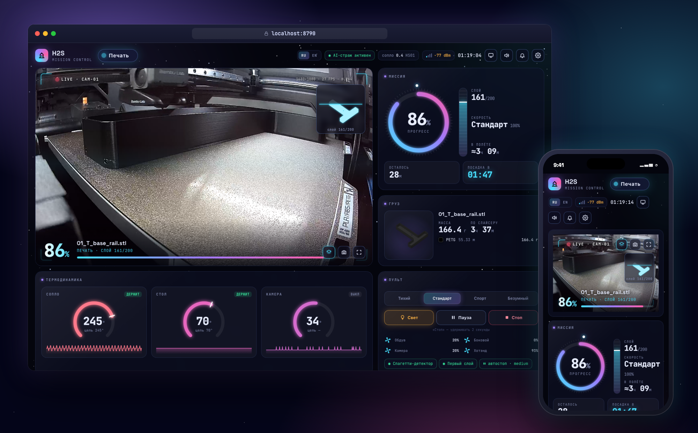
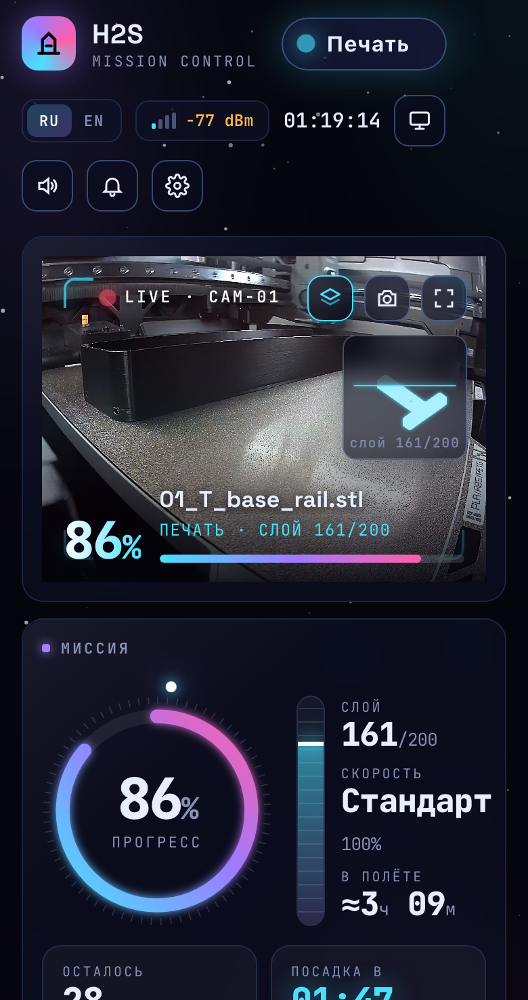

# Mission Control для Bambu Lab

Локальный дашборд для 3D-принтеров Bambu Lab в стиле центра управления полётами. Живая камера в родном качестве, прогресс, температуры, AMS, история печатей и их стоимость — на одном экране, для одного или нескольких принтеров. Работает только в домашней сети, облако Bambu не нужно. Сделан и проверен на H2S с AMS 2 Pro и AMS HT. Интерфейс на русском и английском.

  

<p align="center"></p>

## Возможности

<table>
<tr>
<td width="290" valign="top"></td>
<td valign="top">

**Камера**
- **Родное качество**: 1680×1080, 30 кадров/с, без перекодирования, около 250 КБ/с. В углу видео реальные разрешение и FPS.
- **Зум и перемещение**: колесо мыши или щипок двумя пальцами, перетаскивание, двойной клик. Удобно рассматривать первый слой.
- **Модель поверх камеры**: силуэт модели заполняется по мере печати, линия показывает текущий слой.
- **Трансляция в YouTube, Twitch, Kick, Facebook** или на любой RTMP-сервер, в несколько сразу. С оформлением дашборда поверх видео (процент, задание, слой, остаток времени, температуры; кадр 1920×1080, аппаратное кодирование на Mac) или чистым видео без перекодирования. Кнопка под видео, ключи в настройках.
- **Снимок в оформлении дашборда**: кадр в полном разрешении с рамками, процентом, именем задания, слоем, полосой прогресса и силуэтом модели. Плюс **полный экран**. Если браузер не умеет новый формат видео, сам включается запасной поток.

**Печать**
- **Миссия**: кольцо прогресса, шкала слоёв, сколько осталось, во сколько закончится, скорость.
- **Груз**: превью модели и расход пластика по цветам из файла задания.
- **Температуры** сопла, стола и камеры: текущая и целевая, графики за 30 минут.
- **AMS**: катушки в реальном цвете с остатком, активная подсвечена; влажность и температура блоков.
- **Пульт**: скорость, свет, пауза и пуск, стоп (удерживать 2 секунды), вентиляторы, статус ИИ-контроля печати.
- **Температуры, вентиляторы и сушка AMS** с пульта, с ограничениями на сервере. Включаются в настройках, если на принтере включён Developer Mode (см. «Ограничения»).

**История и деньги**
- **Журнал печатей**: каждая печать с финальным снимком, длительностью, граммами и отдельно стоимостью пластика, электричества и итого. Переживает перезапуск сервера посреди печати.
- **Отчёт о печати** (клик по строке журнала): 3D-просмотр реальных траекторий из G-code с ползунком «напечатано до слоя N» и цветами по типам линий, финальное фото в оформлении дашборда, превью пластины, графики температур и прогресса за всю печать, лента событий, стоимость. Скачивание фото и 3D-кадра.
- **Статистика** за неделю, месяц, год или всё время: печати, часы, пластик, кВт·ч, стоимость, доля успешных; графики по дням и по материалам.
- **Стоимость**: цены пластика по материалам и тарифы день/ночь в настройках, средняя мощность по умолчанию 180 Вт. Оценка текущей печати в реальном времени.
- **Прогноз катушки**: хватит ли пластика в слоте AMS до конца печати, с предупреждением заранее.

**Ошибки и события**
- **Ошибки текстом**: коды HMS и ошибок печати объяснены по официальной базе Bambu, на русском и английском.
- **Звук**: мелодия по окончании печати, сигналы при паузе и ошибке.
- **Уведомления браузера** со снимком с камеры.
- **Бортжурнал**: смена состояний и этапов, ошибки, отправленные команды.

**Удобство**
- **Телефон**: страница перестраивается под узкий экран, ставится на домашний экран как приложение со своей иконкой.
- **Режим киоска** для планшета на стене или телевизора: камера на весь экран, крупные цифры, экран не гаснет.
- **Пароль на пульт** (необязательно): смотреть может любой, управлять только после входа.
- **Автозапуск** при входе в систему, сам перезапускается при сбоях.
- **Настройка в браузере**: поиск принтера в сети, проверка связи по шагам.
- **Несколько принтеров**: переключатель в шапке с состоянием каждого, у всех своя камера и журнал, общие история и статистика.
- **Главный экран** одним нажатием: иконка слева от названия принтера. Кнопка «Назад» в браузере и на мышке тоже всегда возвращает на главный экран.
- **RU / EN** переключателем в шапке.

</td>
</tr>
</table>

## Установка

**macOS / Linux** (Терминал):

```sh
git clone https://github.com/sthal/bambu-dash.git && cd bambu-dash
./run.sh
```

**Windows** (PowerShell или cmd):

```bat
git clone https://github.com/sthal/bambu-dash.git && cd bambu-dash
run.bat
```

Сам `git clone` ничего не устанавливает и не запускает: Git этого не позволяет. Всё делает `run.sh` / `run.bat`:

- **Проверяет Python 3.9+ и ffmpeg.** Если чего-то нет, печатает точные команды установки для вашей системы и останавливается:

  | Система | Команды |
  |---|---|
  | macOS | `brew install python ffmpeg`. Если Homebrew нет, скрипт покажет, как его поставить и добавить в PATH, а также путь без Homebrew: скачать ffmpeg одной командой в папку проекта `bin/` |
  | Windows | `winget install -e --id Python.Python.3.12`<br>`winget install -e --id Gyan.FFmpeg` |
  | Debian / Ubuntu | `sudo apt install -y python3 python3-venv ffmpeg` |

  После установки запустите скрипт снова. На Windows сначала откройте **новое** окно терминала, чтобы подхватился PATH.
- **При первом запуске** создаёт `.venv` и ставит зависимости из `requirements.txt` (только `paho-mqtt`).
- **Запускает сервер.** Дальше откройте `http://localhost:8790`.

Если `git` не установлен: macOS `xcode-select --install`, Windows `winget install -e --id Git.Git`. Можно и без него: скачайте ZIP со страницы репозитория.

> Проверено на macOS. Windows-скрипты написаны, но на живой Windows ещё не запускались. Если что-то не так, откройте issue.

### Первая настройка

При первом запуске откроется **страница настройки** (`/setup`):

1. **«Искать в сети»** находит принтеры Bambu Lab в вашей подсети и сам подставляет IP и серийный номер.
2. Введите **Access Code**: экран принтера → Настройки → Сеть (WLAN).
3. **«Проверить связь»** по шагам покажет, что не так: принтер не отвечает, код не подошёл или статус не приходит.
4. **«Сохранить и подключить»** запишет `config.json` (права `600`) и подключится без перезапуска.

Ещё принтеры добавляются там же: «Мои принтеры» → «Добавить принтер». Старый `config.json` с одним принтером переводится в новый формат автоматически.

Для видео на принтере должна быть включена опция **LAN Mode Liveview**. Потом настройки открываются шестерёнкой в шапке. Там же можно задать пароль на пульт. Порт меняется в настройках или переменной `PORT=8800 ./run.sh`.

### Трансляции

Ключи вводятся в настройках, раздел «Трансляции»; хранятся только в `config.json`. Для **оформления поверх трансляции** нужен ffmpeg с фильтром `drawtext`. Сборка из Homebrew его не содержит, поэтому положите полную сборку в папку проекта (на сервере она подхватится сама):

```sh
mkdir -p bin && curl -L https://ffmpeg.martin-riedl.de/redirect/latest/macos/$( [ "$(uname -m)" = arm64 ] && echo arm64 || echo amd64 )/release/ffmpeg.zip -o /tmp/ffmpeg.zip && unzip -o /tmp/ffmpeg.zip -d bin && rm /tmp/ffmpeg.zip
```

Без неё трансляция идёт чистым видео. YouTube и другие сервисы требуют звуковую дорожку, поэтому в поток добавляется тишина.

### Автозапуск

- **macOS:** `./autostart.sh` (убрать: `./autostart.sh --remove`). Лог пишется в `server.log`. При первом запуске macOS может спросить разрешение для Python на доступ к локальной сети — его нужно дать.
- **Windows:** `powershell -ExecutionPolicy Bypass -File autostart.ps1` (убрать: добавьте `-Remove`). Пока не проверено на живой Windows.

### Телефон, планшет, телевизор

- **Телефон**: откройте `http://<IP компьютера>:8790`. На iPhone в Safari: «Поделиться» → «На экран „Домой“».
- **Киоск**: кнопка с монитором в шапке или адрес `http://<IP компьютера>:8790/?kiosk=1`. Выход: Esc или та же кнопка.
- **Уведомления браузера** работают только на `localhost` или по HTTPS (ограничение браузеров). С телефона по адресу из домашней сети они не сработают.
- **Новый формат видео** на iPhone требует iOS 17.1 или новее, иначе включается запасной поток (1280 px, 15 кадров/с).

## Как устроено

`server.py` — один процесс на Python:

| Канал | Порт принтера | Зачем |
|---|---|---|
| MQTT over TLS | 8883 | статус в реальном времени и команды |
| RTSPS | 322 | камера: родной H.264 упаковывается во фрагментированный MP4 без перекодирования, один общий `ffmpeg` на всех зрителей, со сторожем от зависаний. Запасной поток: MJPEG |
| FTPS (implicit) | 990 | `.3mf` текущего задания: превью пластины и `slice_info` |

Браузер получает состояние через SSE (`/events`), видео через `/video.mp4` или `/stream.mjpg`. Все тексты сервер отдаёт сразу на двух языках.

На macOS программы, запущенные автозапуском, не могут ходить в локальную сеть без разрешения, а консольному ffmpeg его не выдать. Поэтому ffmpeg подключается к самому серверу на `127.0.0.1`, а сервер пересылает байты принтеру. Шифрование остаётся сквозным: сервер ничего не расшифровывает.

Базу текстов ошибок можно обновить: `python3 tools/update_hms.py`.

3D-просмотр строится из G-code внутри `.gcode.3mf` (`toolpath.py`): траектории экструзии упаковываются в ~1 МБ и хранятся в истории. Самой 3D-модели (STL) в нарезанном файле Bambu нет. Для печатей, начатых до записи истории, 3D восстанавливается, пока файл ещё лежит на принтере. 3D-просмотр загружает three.js из CDN, поэтому нужен интернет.

## Безопасность

- **Access Code хранится только в `config.json` на вашем компьютере.** Файл в `.gitignore` и в репозиторий не попадает.
- **API никогда не возвращает код**, только признак «код сохранён».
- **Сохранённый код не уходит на другой адрес.** Если в настройках меняется IP или серийный номер, код нужно ввести заново, иначе любой в сети мог бы перенаправить сервер на свой адрес и получить код.
- **Принтером считается только устройство с сертификатом от BBL Technologies**, серийный номер берётся из этого сертификата.
- **Пароль на пульт** хранится только как хеш (PBKDF2), вход живёт 30 дней в cookie. После 5 неверных попыток вход блокируется на 5 минут. Смена пароля разлогинивает всех. Забыли пароль: удалите строки `password_hash` и `session_secret` из `config.json` и перезапустите сервер.

## Ограничения

- **Без пароля пульт и настройки открыты всем в локальной сети.** Код при этом не утекает, но поставить печать на паузу может любой. Задайте пароль в настройках.
- **Температуры, вентиляторы и сушка AMS требуют Developer Mode** на свежих прошивках (проверено на H2S): без него принтер отвечает «mqtt message verify failed» и показывает уведомление HMS 0500_0500_0001_0007. Поэтому эти контролы по умолчанию скрыты: они появляются, только если в настройках принтера отмечено «На принтере включён Developer Mode». Если принтер всё равно откажет, дашборд покажет подсказку и перестанет слать эти команды до нажатия «Попробовать снова». Developer Mode включается на принтере (Настройки → Сеть → LAN Only + Developer Mode), но тогда перестают работать облако Bambu и Handy.
- **Свет, пауза, пуск, стоп и скорость** принимаются и без Developer Mode.
- **Мощность 180 Вт** — средняя оценка для H2S. С розеткой-счётчиком цифры будут точнее.
