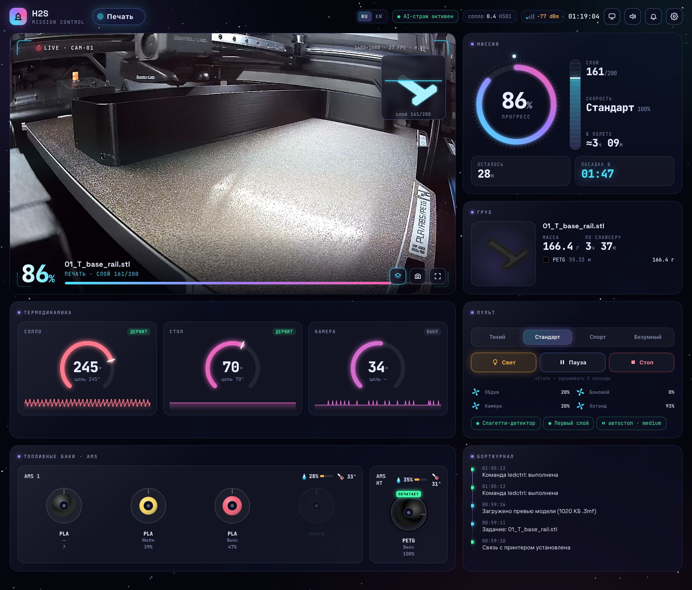

# H2S Mission Control

Локальный дашборд для 3D-принтера Bambu Lab в стиле центра управления полётами. Живая камера, прогресс, температуры, AMS и пульт на одном экране. Работает только в домашней сети, без облака Bambu. Сделан и проверен на H2S с AMS 2 Pro и AMS HT. Интерфейс на русском и английском.

  

<p align="center"></p>

## Быстрый старт

**macOS / Linux** (Терминал):

```sh
git clone https://github.com/sthal/bambu-dash.git && cd bambu-dash
./run.sh
```

**Windows** (PowerShell или cmd):

```bat
git clone https://github.com/sthal/bambu-dash.git && cd bambu-dash
run.bat
```

Сам `git clone` ничего не устанавливает и не запускает: Git этого не позволяет. Всё делает `run.sh` / `run.bat`:

- **Проверяет Python 3.9+ и ffmpeg.** Если чего-то нет, печатает точные команды установки для вашей системы и останавливается:

  | Система | Команды |
  |---|---|
  | macOS | `brew install python ffmpeg`. Если Homebrew нет, скрипт покажет, как его поставить и добавить в PATH, а также путь без Homebrew: скачать ffmpeg одной командой в папку проекта `bin/` |
  | Windows | `winget install -e --id Python.Python.3.12`<br>`winget install -e --id Gyan.FFmpeg` |
  | Debian / Ubuntu | `sudo apt install -y python3 python3-venv ffmpeg` |

  После установки запустите скрипт снова. На Windows сначала откройте **новое** окно терминала, чтобы подхватился PATH.
- **При первом запуске** создаёт `.venv` и ставит зависимости из `requirements.txt` (только `paho-mqtt`).
- **Запускает сервер.** Дальше откройте `http://localhost:8790`.

Если `git` не установлен: macOS `xcode-select --install`, Windows `winget install -e --id Git.Git`. Можно и без него: скачайте ZIP со страницы репозитория.

### Первая настройка

При первом запуске откроется **страница настройки** (`/setup`):

1. **«Искать в сети»** находит принтеры Bambu Lab в вашей подсети и сам подставляет IP и серийный номер.
2. Введите **Access Code**: экран принтера → Настройки → Сеть (WLAN).
3. **«Проверить связь»** по шагам покажет, что не так: принтер не отвечает, код не подошёл или статус не приходит.
4. **«Сохранить и подключить»** запишет `config.json` (права `600`) и подключится без перезапуска.

Потом настройки открываются шестерёнкой в шапке дашборда. С телефона: `http://<IP компьютера>:8790`. Порт меняется в настройках или переменной `PORT=8800 ./run.sh`.

Для видео на принтере должна быть включена опция **LAN Mode Liveview**.

> Проверено на macOS. Windows-скрипты написаны, но на живой Windows ещё не запускались. Если что-то не так, откройте issue.

## Что показывает

<table>
<tr>
<td width="290" valign="top"></td>
<td valign="top">

- **Живая камера** с HUD: прогресс, слой, этап; снимок и полный экран.
- **Миссия**: кольцо прогресса, шкала слоёв, осталось, время окончания, скорость.
- **Груз**: превью модели и расход пластика из `.3mf` задания (берётся с принтера по FTPS).
- **Термодинамика**: сопло, стол, камера: текущая и целевая температура, графики за 30 минут.
- **AMS**: катушки в реальном цвете с остатком, активная подсвечена; влажность и температура блоков.
- **Пульт**: скорость, свет, пауза/пуск, стоп (удерживать 2 секунды), вентиляторы, статус ИИ-контроля.
- **Бортжурнал**: смена состояний и этапов, ошибки, коды HMS со ссылкой на wiki Bambu.
- **Телефон**: та же страница перестраивается под узкий экран. Откройте `http://<IP компьютера>:8790`.
- **Переключатель RU / EN** в шапке, выбор запоминается.

</td>
</tr>
</table>

## Как устроено

`server.py` — один процесс на Python:

| Канал | Порт принтера | Зачем |
|---|---|---|
| MQTT over TLS | 8883 | статус в реальном времени и команды |
| RTSPS | 322 | камера; один общий `ffmpeg` перекодирует в MJPEG для всех вкладок и сам останавливается, когда никто не смотрит |
| FTPS (implicit) | 990 | `.3mf` текущего задания: превью пластины и `slice_info` |

Браузер получает состояние через SSE (`/events`), видео через `/stream.mjpg`. Все тексты сервер отдаёт сразу на двух языках, язык выбирается на странице.

## Безопасность

- **Access Code хранится только в `config.json` на вашем компьютере.** Файл в `.gitignore` и в репозиторий не попадает.
- **API никогда не возвращает код**, только признак «код сохранён».
- **Сохранённый код не уходит на другой адрес.** Если в настройках меняется IP или серийный номер, код нужно ввести заново, иначе любой в сети мог бы перенаправить сервер на свой адрес и получить код.
- **Принтером считается только устройство с сертификатом от BBL Technologies**, серийный номер берётся из этого сертификата.

## Ограничения

- **Команды управления** (пауза, стоп, свет, скорость) на свежих прошивках Bambu могут отклоняться без Developer Mode. Ответ принтера появится в бортжурнале.
- **Пульт и страница настройки открыты всем в локальной сети**, авторизации нет. Код при этом не утекает (см. «Безопасность»), но поставить печать на паузу может любой, кто откроет страницу.
